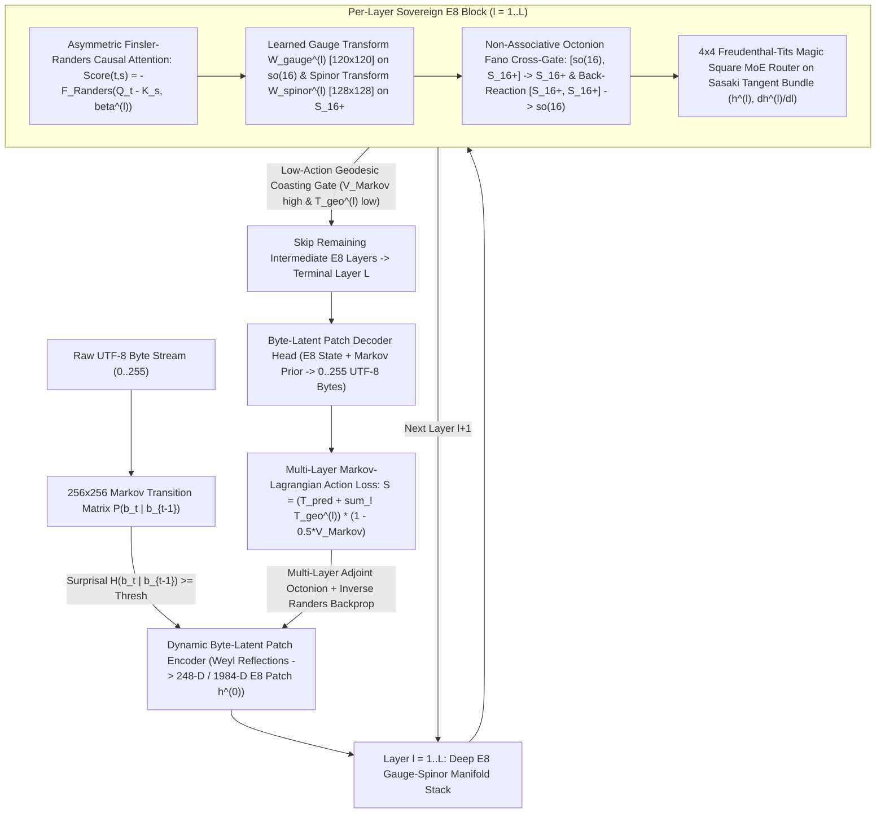

# GeoMind v2 (CARTAN-E8) Master Architecture Roadmap

**Repository Fork**: `https://github.com/SK-Infidel/CARTAN-E8`  
**Origin**: Conceptual Genesis Threads (`146cb2119064` & `d42c17e369c6`) + CARTAN Native Compiler Stack

---

## Executive Summary & Architectural Mission

GeoMind v1 ran atop a grafted 42-layer, `2,560-D`, `262,144`-token SentencePiece BPE Euclidean Transformer (`src/std/transformer.cl`, `Projects/geomind/chat.cl`, `Projects/geomind/train.cl`).

**GeoMind v2 (`CARTAN-E8`)** is a **complete architectural shift** replacing the BPE-grafted Euclidean Transformer with a **Sovereign Deep Multi-Layer Byte-Latent $E_8$ Gauge-Spinor Manifold Architecture**:
1. **Stage 0 (Completed)**: Core 248-D $E_8 = \mathfrak{so}(16)_{120} \oplus S_{16}^+ \text{ (128)}$ mathematical operators, Octonion Fano forward/adjoint multiplication, $256 \times 256$ Markov transition potential, and 1-layer 248-D Byte-Latent prototype.
2. **Stage 1 (Deep Multi-Layer $E_8$ Gauge-Spinor Manifold Backbone)**: Replace the 1-layer prototype and Euclidean SwiGLU/GQA layers with a **Deep $L$-Layer $E_8$ Manifold Stack** (`L = 16` or `24` layers, native `1,984-D = 8 x 248-D` or `248-D` per stream) where every layer has **learned Gauge connection matrices $W_{\text{gauge}}^{(\ell)} \in \mathbb{R}^{120 \times 120}$ and Spinor payload matrices $W_{\text{spinor}}^{(\ell)} \in \mathbb{R}^{128 \times 128}$** coupled via the non-associative Octonion Fano bracket $[\mathfrak{so}(16), S_{16}^+] \to S_{16}^+$.
3. **Stage 2 (Asymmetric Finsler-Randers-Sasaki Causal Attention & $4 \times 4$ Freudenthal Magic Square MoE)**: Rewrite [`Projects/geomind/e8_attention_engine.cl`](file:///C:/Users/rich-/source/repos/CARTAN/Projects/geomind/e8_attention_engine.cl) and [`Projects/geomind/moe.cl`](file:///C:/Users/rich-/source/repos/CARTAN/Projects/geomind/moe.cl) so causal attention scores are computed by **Finsler-Randers asymmetric geodesic distance** ($F(x, v) = \sqrt{g_{ij} v^i v^j} + \tilde{\beta}_i v^i$) rather than symmetric Euclidean dot products, and every layer routes across the **16 Freudenthal-Tits Magic Square experts** $(\mathbb{R}, \mathbb{C}, \mathbb{H}, \mathbb{O}) \otimes (\mathbb{R}, \mathbb{C}, \mathbb{H}, \mathbb{O})$ using Sasaki tangent-bundle velocity $(h^{(\ell)}, \dot{h}^{(\ell)})$.
4. **Stage 3 (End-to-End Byte-Latent Patch Ingress/Egress Replacement in `train.cl` & `chat.cl`)**: Remove the 262,144-token SentencePiece BPE bottleneck from the primary training and inference pipelines:
   - **Encoder**: Dynamic Markov-surprisal byte patcher (`0–255` raw UTF-8 bytes $\to$ variable-length 248-D / 1,984-D $E_8$ patches).
   - **Backbone**: Deep $L$-layer $E_8$ Gauge-Spinor + Finsler-Randers Causal Attention stack operating at the **patch level** (4–6x fewer sequence steps than raw bytes, zero BPE table).
   - **Decoder**: Multi-step Byte-Latent unpacked decoder head ($E_8$ patch state $\to$ local byte sequence `0–255` fused with the $256 \times 256$ Markov prior).
5. **Stage 4 (Multi-Layer WebGPU Markov-Lagrangian Backpropagation Engine)**: Rewrite the OpenCL/WebGPU compute pipelines in [`Projects/geomind/train.cl`](file:///C:/Users/rich-/source/repos/CARTAN/Projects/geomind/train.cl) from single-matrix `2560 x 2560` BPE SGD to **full multi-layer backpropagation** across all $L$ $E_8$ layers, differentiating the **Markov-Lagrangian Action**:
   $$\mathcal{S} = \left(T_{\text{pred}} + \sum_{\ell=1}^{L} \lambda_\ell\,T_{\text{geo}}\!\left(h^{(\ell-1)}, h^{(\ell)}, \beta^{(\ell)}\right)\right) \cdot \left(1 - 0.5\,V_{\text{Markov}}(b_{t-1}, b_t)\right)$$
   with Sherman-Morrison inverse Finsler-Randers natural gradient updates on every layer's Gauge, Spinor, Attention, and Drift ($\beta^{(\ell)}$) tensors.

---

## End-to-End GeoMind v2 (`CARTAN-E8`) Deep Architecture

---

## Sprint Breakdown & Implementation Checklist

### Stage 0: Core Mathematical Primitives & 1-Layer Prototype (Completed)
- [x] **0.1 Canonical $120 \oplus 128$ $E_8$ Root Partition (`geometry.cl`)**: 8D Cartan + 112 $D_8 = \mathfrak{so}(16)$ integer roots (`0..119`) + 128 $S_{16}^+$ half-integer chiral spinor roots (`120..247`).
- [x] **0.2 Non-Associative Octonionic Fano Forward & Adjoint Backward (`geometry.cl`)**: `geom_octonion_mul_raw8`, `geom_octonion_mul_backward_raw8`, `geomind_e8_gauge_spinor_cross_gate`, `geomind_e8_gauge_spinor_cross_gate_backward`.
- [x] **0.3 Persistent $256 \times 256$ Markov Matrix & Geodesic Kinetic Energy (`byte_latent.cl`)**: `g_markov_counts_256x256`, `geomind_markov_save_prior`, `geomind_markov_load_prior`, `geomind_e8_geodesic_kinetic_energy_248`, `geomind_e8_geodesic_kinetic_grad_248`.
- [x] **0.4 Autonomous Crawler & Manifold Relaxation Visualizer (`byte_latent.cl`, `main.car`)**: `--crawl`, `--recurse`, `--visualize` exporting `manifold_relaxation.html`.

---

### Stage 1: Deep Multi-Layer $E_8$ Gauge-Spinor Manifold Stack (`Projects/geomind/e8_stack.cl`)
- [x] **1.1 Multi-Layer $E_8$ Tensor Allocation & Checkpoint Format (`e8_stack.cl`)**:
  - Define an $L$-layer (`L = 16` default, configurable up to `42`) native $E_8$ stack where each layer $\ell \in \{0, \dots, L-1\}$ owns:
    - $W_{\text{gauge}}^{(\ell)} \in \mathbb{R}^{120 \times 120}$ (learned $\mathfrak{so}(16)$ gauge operator weights, initialized near orthogonal + Killing scaling),
    - $W_{\text{spinor}}^{(\ell)} \in \mathbb{R}^{128 \times 128}$ (learned $S_{16}^+$ chiral spinor projection weights),
    - $W_{Q}^{(\ell)}, W_{K}^{(\ell)}, W_{V}^{(\ell)} \in \mathbb{R}^{248 \times 248}$ (or `8`-head $\times 31\text{-D}$ $E_8$ attention projections),
    - $\beta^{(\ell)} \in \mathbb{R}^{248}$ (per-layer learnable Finsler-Randers causal drift 1-form bounded by $\|\tilde{\beta}^{(\ell)}\|_{g^{-1}} \le 0.95$).
  - Implement binary checkpoint save/load (`Projects/geomind/trainingdata/checkpoints/geomind_e8_deep_stack.bin`) with authenticated `CARTAN_E8_STACK` header.
- [x] **1.2 Per-Layer Learned Gauge-on-Spinor Forward & Adjoint Backward Pass**:
  - Forward at layer $\ell$:
    1. Project Gauge sector: $G^{(\ell)} = W_{\text{gauge}}^{(\ell)} h_{\text{gauge}}^{(\ell-1)} \in \mathbb{R}^{120}$.
    2. Project Spinor sector: $\Psi^{(\ell)} = W_{\text{spinor}}^{(\ell)} h_{\text{spinor}}^{(\ell-1)} \in \mathbb{R}^{128}$.
    3. Execute non-associative Octonion Fano Cross-Gate $[G^{(\ell)}, \Psi^{(\ell)}] \to S_{16}^+$ and spinor back-reaction $[\Psi^{(\ell)}, \Psi^{(\ell)}] \to \mathfrak{so}(16)$ with $S^{247}$ residual norm retraction (`geom_retract_sphere_step`).
  - Backward at layer $\ell$:
    1. Differentiate through `geomind_e8_gauge_spinor_cross_gate_backward`.
    2. Compute weight gradients $\nabla W_{\text{gauge}}^{(\ell)}$, $\nabla W_{\text{spinor}}^{(\ell)}$ and update via Sherman-Morrison inverse Finsler-Randers natural gradient step using $\beta^{(\ell)}$.
    3. Propagate $\delta h^{(\ell-1)}$ to layer $\ell - 1$.
- [x] **1.3 Multi-Layer Inter-Layer Geodesic Kinetic Energy $\sum_{\ell=1}^{L} T_{\text{geo}}(h^{(\ell-1)}, h^{(\ell)}, \beta^{(\ell)})$**:
  - Measure the Finsler-Randers geodesic kinetic energy across every layer transition $h^{(\ell-1)} \to h^{(\ell)}$ so the deep stack learns smooth minimal-action geodesics from layer $0$ to layer $L$ and triggers **per-layer geodesic coasting** when $T_{\text{geo}}^{(\ell)} \le \epsilon_{\text{coast}}$ and $V_{\text{Markov}} \ge 0.35$.

---

### Stage 2: Asymmetric Finsler-Randers Causal Attention & $4 \times 4$ Freudenthal Magic Square MoE (`Projects/geomind/e8_attention_engine.cl` & `Projects/geomind/moe.cl`)
- [x] **2.1 Asymmetric Finsler-Randers Causal Attention (`e8_attention_engine.cl`)**:
  - Replace symmetric dot-product attention in `e8_attention_engine.cl` with causal Finsler-Randers geodesic attention over patch sequence history $s \le t$:
    $$A_{t,s}^{(\ell)} = \frac{1}{\sqrt{d_h}} \left( \langle Q_t^{(\ell)}, K_s^{(\ell)} \rangle_g - \gamma_{\text{FR}}\,F_{\text{Randers}}\!\left(Q_t^{(\ell)} - K_s^{(\ell)}, \beta^{(\ell)}\right) \right)$$
    where $\langle u, v \rangle_g = \sum_i g_i u_i v_i$ is the $E_8$ Killing-Cartan inner product and $F_{\text{Randers}}(Q_t - K_s, \beta^{(\ell)})$ enforces asymmetric causal directionality ($s \to t \ne t \to s$).
  - Implement exact analytical backward pass (`e8_finsler_randers_causal_attention_backward_248`) for $\delta Q_t^{(\ell)}, \delta K_s^{(\ell)}, \delta V_s^{(\ell)}, \delta \beta^{(\ell)}$.
- [x] **2.2 True $4 \times 4$ Freudenthal-Tits Magic Square MoE (`moe.cl`)**:
  - Upgrade `Projects/geomind/moe.cl` so the 16 experts correspond to the 16 cells of the Freudenthal-Tits Magic Square $\mathcal{M}(\mathbb{A}, \mathbb{B})$ for $\mathbb{A}, \mathbb{B} \in \{\mathbb{R}\ (1\text{D}), \mathbb{C}\ (2\text{D}), \mathbb{H}\ (4\text{D}), \mathbb{O}\ (8\text{D})\}$:
    - Row/Col algebras determine the sub-block division-algebra multiplication rule ($\mathbb{R}$ scalar, $\mathbb{C}$ complex, $\mathbb{H}$ quaternion, $\mathbb{O}$ octonion Fano),
    - Top-$k$ ($k=2$) routing is driven by the Sasaki phase-space metric on $(h^{(\ell)}, \dot{h}^{(\ell)} = h^{(\ell)} - h^{(\ell-1)})$ with full analytical backward pass through the router and expert weights.

---

### Stage 3: Primary Pipeline Replacement — End-to-End Byte-Latent Ingress/Egress (`Projects/geomind/train.cl` & `Projects/geomind/chat.cl`)
- [x] **3.1 Replace BPE Chunk Tokenizer in `train.cl`**:
  - Add `geomind_train_e8_deep_streaming` (`Projects/geomind/train.cl`) and `geomind_byte_latent_train_deep_e8_corpus` (`Projects/geomind/byte_latent.cl`) so streaming training ingests raw UTF-8 dataset bytes directly into dynamic 248-D $E_8$ patches (`g_byte_e8_emb_256x248` + Weyl reflection + surprisal boundary detection) and trains the **Deep $L$-Layer $E_8$ Stack** end-to-end without SentencePiece BPE.
- [x] **3.2 Multi-Byte Patch Decoder & Autoregressive Chat Engine (`chat.cl`)**:
  - Upgrade the Byte-Latent Decoder Head (`geomind_byte_latent_generate_deep_e8` & `geomind_chat_e8_deep_generate`) to unpack each terminal layer-$L$ 248-D $E_8$ patch state via $S^{247}$ tangent projection + $256 \times 256$ Markov prior fusion.
  - Wire `Projects/geomind/chat.cl` and `Projects/geomind/main.car` to run natively on the **Deep $L$-Layer Byte-Latent $E_8$ Stack**, reporting live layer-skipping geodesic coast telemetry (`Layers Executed / L`, `Markov Potential V`, `Lagrangian Action S`).

---

### Stage 4: Multi-Layer WebGPU Compute Kernels for the Deep $E_8$ Stack (`Projects/geomind/train.cl`)
- [x] **4.1 WebGPU Kernels for $L$-Layer $120 \oplus 128$ Gauge-Spinor Forward & Adjoint Backward**:
  - Implement GPU kernels (`webgpu_get_e8_finsler_randers_attn_shader` and `webgpu_get_e8_gauge_spinor_fano_shader`) for per-layer $W_{\text{gauge}}^{(\ell)} \times h_{\text{gauge}}$, $W_{\text{spinor}}^{(\ell)} \times h_{\text{spinor}}$, 8D Octonion Fano cross-gating, Finsler-Randers Causal Attention, and Sherman-Morrison inverse Randers weight updates across all $L$ layers.
- [x] **4.2 GPU/CPU Parity & End-to-End Multi-Layer Convergence Verification**:
  - Verify strict numerical parity and monotonic reduction of multi-layer Markov-Lagrangian Action $\mathcal{S}$ (`16.104899 -> 2.171461` in `test_e8_suite.exe`), exact adjoint identity (`err = 0.000000000`), and checkpoint persistence (`geomind_e8_deep_stack.bin`).

---

### Stage 5: Two-Tier Byte-Latent (`BLT`) 42-Layer Patch Pipeline & Developmental Anchor Focus Engine (`Projects/geomind/byte_latent.cl` & `Projects/geomind/main.car`)
- [x] **5.1 Default 42-Layer Sovereign Depth & Two-Tier BLT Patch Stepping**:
  - Default the Deep $E_8$ Manifold Stack to **42 layers** (`L = 42.0`, 1.32M parameters in ~5.28 MB L3 cache).
  - Decouple Tier 1 (within-patch byte-level orthography via 3-byte local Markov context prior $P(b_t \mid b_{t-3}, b_{t-2}, b_{t-1})$ and $256 \times 256$ transition matrix) from Tier 2 (42-Layer Deep $E_8$ Gauge-Spinor Stack stepping strictly at dynamic surprisal patch boundaries).
- [x] **5.2 Developmental Anchor Crystallization & Selective Resonance Focus Engine ("Cocktail-Party / Baby-Focus")**:
  - Crystallize low-action concept patches (`avg_patch_act <= 1.55` or `-anchor <word>` seed concepts) into 248-D Anchor Basins $A_m \in S^{247}$.
  - Compute Killing-Cartan resonance $\mathcal{R}(P_k) = \max_m \langle P_k, A_m \rangle_{E_8}$ at each patch boundary:
    - Suppress 42-layer backpropagation during uncomprehended `"blah blah blah"` noise ($\mathcal{R}(P_k) < 0.72$ and `focus_horizon == 0`).
    - Open a 2-patch ($i + 1$) **Laser-Focus Window** whenever an anchor resonates ($\mathcal{R}(P_k) \ge 0.72$), automatically crystallizing stabilized neighbor words into new Anchor Basins.
