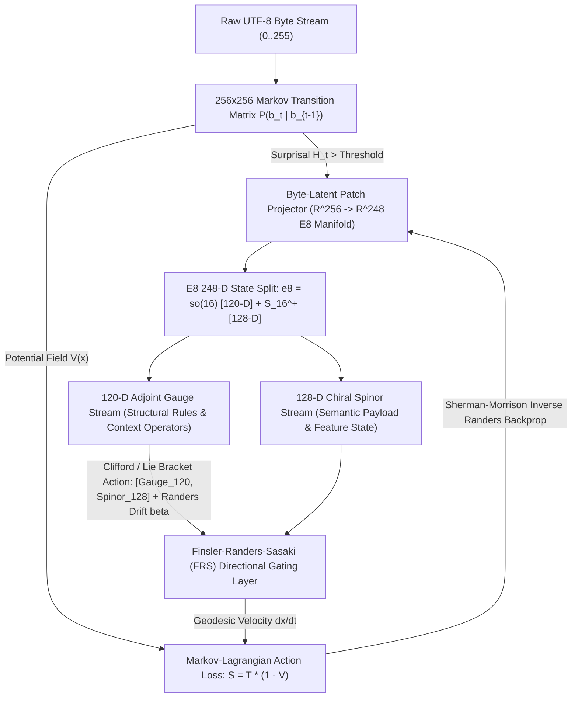

# GeoMind v2 (CARTAN-E8) Master Architecture Roadmap

**Repository Fork**: `https://github.com/SK-Infidel/CARTAN-E8`  
**Origin**: Conceptual Genesis Threads (`146cb2119064` & `d42c17e369c6`) + CARTAN Native Compiler Stack

---

## Executive Summary & Architectural Mission

GeoMind v1 established the CARTAN compiler, WebGPU compute shaders, 240 canonical $E_8$ root projections, 8 Lie subgroup streams, and Finsler-Randers-Sasaki (FRS) gradient clipping—currently running atop a grafted 42-layer, 262,144-token BPE backbone.

**GeoMind v2 (`CARTAN-E8`)** transitions from a BPE-grafted hybrid to the **pure native $E_8$ + Finsler-Randers-Sasaki + Byte-Latent + Markov-Lagrangian architecture** conceived in the original GeoMind genesis specification:
1. **Tokenizer-Free Byte-Latent Dynamic Patching (`0–255` UTF-8 Ingress/Egress)**
2. **Explicit $120\text{-D} \oplus 128\text{-D}$ Gauge-on-Spinor Cross-Gating ($\mathfrak{e}_8 = \mathfrak{so}(16) \oplus S_{16}^+$)**
3. **Markov-Lagrangian Principle of Least Action ($\mathcal{S} = \int (T - V)\,dt$) Training & Geodesic Inference**
4. **Autonomous Domain-Bounded Recursive Web Crawler (`--crawl`) & Live Manifold Relaxation Telemetry (`--visualize`)**

---

## End-to-End Architecture Dataflow



---

## Phase 1: Explicit $120\text{-D} \oplus 128\text{-D}$ Gauge-on-Spinor Cross-Gating ($\mathfrak{e}_8 = \mathfrak{so}(16) \oplus S_{16}^+$)

### Goal
Replace flat additive stream averaging (`* 0.125` in `Projects/geomind/streams.cl`) with the true graded Lie algebra decomposition of $\mathfrak{e}_8$:
$$\mathfrak{e}_8 = \mathfrak{g}_0 \oplus \mathfrak{g}_1 = \mathfrak{so}(16) \oplus S_{16}^+ \quad (\dim \mathfrak{g}_0 = 120,\ \dim \mathfrak{g}_1 = 128)$$
where the **120-D Gauge stream** (112 integer roots $\pm e_i \pm e_j$ + 8 Cartan generators) acts as an antisymmetric rotational/gating operator on the **128-D Chiral Spinor payload stream** (128 half-integer roots $\frac{1}{2}(\pm 1)^8$ with even minus signs), steered by the asymmetric Finsler-Randers 1-form $\beta$.

### Checklist
- [ ] **1.1 Canonical 120/128 Partition in `geometry.cl`**:
  - Separate `g_e8_roots_table` into:
    - **Indices `0..7`**: 8-D Cartan subalgebra $\mathfrak{h}$
    - **Indices `8..119`**: 112 integer roots of $D_8 = \mathfrak{so}(16)$ (Total Gauge = `120` dims)
    - **Indices `120..247`**: 128 half-integer chiral spinor roots $S_{16}^+$ (Total Spinor = `128` dims)
- [ ] **1.2 Clifford Gamma Matrix Action $\Gamma: \mathfrak{so}(16) \times S_{16}^+ \to S_{16}^+$**:
  - Precompute the sparse octonionic/Clifford coupling table mapping each of the 120 $\mathfrak{so}(16)$ generators $E_{ij}$ (`0 <= i < j < 16`) to its sign-flip permutation on the 128 spinor coordinates.
- [ ] **1.3 Asymmetric Finsler-Randers Directional Gate (`frs_directional_gate_248`)**:
  - Combine the symmetric Riemannian norm $\alpha(x, v) = \sqrt{g_{ij} v^i v^j}$ with the directional 1-form $\beta(x, v) = b_i v^i$ so forward logical transitions experience a "tailwind" ($\beta < 0$ action reduction) while contradictory transitions hit a "headwind" ($\beta > 0$ suppression).
- [ ] **1.4 WebGPU Shader Kernel (`e8_gauge_spinor_gate.wgsl`)**:
  - Port the $120 \times 128 \to 128$ cross-gating pass and its adjoint backward pass (`e8_gauge_spinor_backward.wgsl`) to native WebGPU compute shaders.

### Cartan Pseudo-Code Specification
```rust
// Projects/geomind/geometry.cl
// Explicit 248-D E8 Decomposition: 120-D Gauge (so(16)) acting on 128-D Spinor (S_16^+)
fn geomind_e8_gauge_spinor_forward(state_248: ptr, randers_b_248: ptr, out_248: ptr) -> float {
    // 1. Extract 120-D Gauge (dims 0..119) and 128-D Spinor (dims 120..247)
    // 2. Compute Lie bracket action [Gauge_120, Spinor_128] -> delta_Spinor_128
    var s = 0.0;
    while (s < 128.0) {
        let spin_val = cartan_vec_get_f32(state_248, 120.0 + s);
        let rot_val  = geomind_clifford_so16_action(state_248, s);
        let b_spin   = cartan_vec_get_f32(randers_b_248, 120.0 + s);
        // Randers directional gating: sigmoid(alpha + beta)
        let gate     = 1.0 / (1.0 + exp(0.0 - (rot_val + b_spin * spin_val)));
        cartan_vec_set_f32(out_248, 120.0 + s, spin_val * gate + rot_val * (1.0 - gate));
        s = s + 1.0;
    }
    // 3. Update 120-D Gauge curvature via spinor back-reaction [Spinor_128, Spinor_128] -> Gauge_120
    var g = 0.0;
    while (g < 120.0) {
        let gauge_val = cartan_vec_get_f32(state_248, g);
        let b_gauge   = cartan_vec_get_f32(randers_b_248, g);
        let gate_g    = 1.0 / (1.0 + exp(0.0 - (gauge_val + b_gauge)));
        cartan_vec_set_f32(out_248, g, gauge_val * gate_g);
        g = g + 1.0;
    }
    return 248.0;
}
```

---

## Phase 2: Markov-Lagrangian Least-Action Training Engine ($\mathcal{S} = \int (T - V)\,dt$)

### Goal
Formulate training and inference around the **Principle of Least Action** on the Finsler-Randers-Sasaki tangent bundle $TM$:
$$\mathcal{S}[\gamma] = \int_{t_0}^{t_1} \mathcal{L}(x, \dot{x})\,dt, \quad \mathcal{L}(x, \dot{x}) = T(x, \dot{x}) \cdot (1 - V_{\text{Markov}}(x_{t-1}, x_t))$$
where:
- **Kinetic Energy $T(x, \dot{x})$**: Prediction divergence + geodesic velocity cost $\frac{1}{2} g_{ij}(x)\dot{x}^i\dot{x}^j + \beta_i(x)\dot{x}^i$ between consecutive manifold states $h_{t-1} \to h_t$.
- **Potential Field $V_{\text{Markov}}$**: A fast $256 \times 256$ (or subword bigram) **Markov Transition Matrix** updated continuously on the raw stream, creating potential wells along statistically established syntax paths so the 248-D $E_8$ manifold dedicates 100% of its gradient capacity to higher-order reasoning and long-range structure.

### Checklist
- [ ] **2.1 Persistent $256 \times 256$ Markov Transition Matrix (`g_markov_transition_matrix`)**:
  - Allocate a $256 \times 256$ float matrix ($65,536$ floats = `256 KB`) tracking empirical byte/patch transition counts and row-normalized probabilities $P(b_t \mid b_{t-1})$.
  - Persist and reload alongside cortical checkpoints (`geomind_markov_prior.bin`).
- [ ] **2.2 Geodesic Kinetic Energy Term ($T_{\text{geodesic}}$)**:
  - Compute velocity $\dot{h}_t = h_t - h_{t-1}$ in 248-D $E_8$ space and evaluate the Finsler-Randers kinetic energy:
    $$T_{\text{geo}}(h_{t-1}, h_t) = \frac{1}{2} \sum_{d=0}^{247} g_d (\dot{h}_t^d)^2 + \sum_{d=0}^{247} \beta_d \dot{h}_t^d$$
- [ ] **2.3 Coupled Markov-Lagrangian Action Loss (`geomind_calculate_lagrangian_action`)**:
  - Combine prediction loss $T_{\text{pred}}$ and trajectory kinetic energy $T_{\text{geo}}$ scaled by the Markov potential well $(1.0 - V_{\text{Markov}}(b_{t-1}, b_t))$.
- [ ] **2.4 Low-Action Geodesic Early-Exit (Inference Speedup)**:
  - During generation, when $V_{\text{Markov}}$ is high and $T_{\text{geo}}$ is below a stability threshold $\epsilon_{\text{geodesic}}$, coast along the manifold geodesic without invoking full deep-layer recomputation.

### Cartan Pseudo-Code Specification
```rust
// Projects/geomind/train.cl
// Coupled Markov-Lagrangian Action Loss: S = (T_pred + lambda * T_geo) * (1.0 - V_markov)
fn geomind_lagrangian_action_step(
    logits: ptr,
    target_byte: float,
    prev_byte: float,
    h_prev_248: ptr,
    h_curr_248: ptr,
    randers_b_248: ptr,
    markov_mat_256x256: ptr
) -> float {
    // 1. Update and query Markov Potential V = P(target_byte | prev_byte)
    let m_idx = prev_byte * 256.0 + target_byte;
    let p_trans = geomind_markov_update_and_get_prob(markov_mat_256x256, prev_byte, target_byte);
    let potential_v = p_trans; // in [0.0, 1.0]

    // 2. Prediction Kinetic Energy (Cross-Entropy over 256 byte channels)
    let t_pred = geomind_byte_cross_entropy(logits, target_byte);

    // 3. Trajectory Geodesic Kinetic Energy on E8 Manifold
    let t_geo = geomind_frs_brainstem_distance(h_prev_248, 0.0, h_curr_248, 0.0, randers_b_248, 248.0);

    // 4. Principle of Least Action: S = T * (1.0 - V)
    let total_kinetic = t_pred + 0.15 * t_geo;
    let action_penalty = total_kinetic * (1.0 - 0.5 * potential_v);
    return action_penalty;
}
```

---

## Phase 3: Byte-Latent Dynamic Patching (Tokenizer-Free Raw UTF-8 Ingress/Egress)

### Goal
Eliminate static BPE vocabulary bottlenecks (`262,144` fixed tokens) by ingesting and emitting raw `0–255` UTF-8 bytes directly into the 248-D $E_8$ manifold, using **Markov transition entropy** to dynamically group predictable byte runs into compact latent patches.

### Checklist
- [ ] **3.1 Direct Byte-to-$E_8$ Embedding Table ($256 \times 248$)**:
  - Replace the massive $262,144 \times 2560$ BPE lookup table (`2.68 GB`) with a compact, cache-resident $256 \times 248$ byte-to-$E_8$ lattice projection (`253 KB`, fitting entirely inside L2 CPU/GPU cache).
- [ ] **3.2 Entropy-Driven Dynamic Patch Boundary Detector**:
  - Compute byte transition surprisal $S_t = -\log_2 P_{\text{Markov}}(b_t \mid b_{t-1})$.
  - Accumulate predictable bytes ($S_t < \tau_{\text{entropy}}$) via fast Weyl reflection / $SO(16)$ gauge pooling into a single 248-D patch vector; emit a new patch boundary whenever $S_t \ge \tau_{\text{entropy}}$.
- [ ] **3.3 Byte-Latent Decoder Head ($248 \to 256$)**:
  - Unpack a 248-D $E_8$ patch state back into autoregressive `0–255` byte logits via the dual Spinor-Gauge readout projection.
- [ ] **3.4 Hybrid Bridge Mode (`--byte-latent`)**:
  - Support both standalone pure Byte-Latent execution (`248-D` native model) and side-channel Byte-Latent fusion for character-exact math, code, and binary inspection.

### Cartan Pseudo-Code Specification
```rust
// src/std/tokenizer.cl / Projects/geomind/byte_latent.cl
fn geomind_byte_latent_encode_stream(
    raw_bytes: ptr,
    byte_len: float,
    byte_emb_256x248: ptr,
    markov_mat_256x256: ptr,
    entropy_thresh: float
) -> ptr {
    let patches_out = cartan_vec_create();
    let accum_248   = cartan_vec_create_zeros(248.0);
    var prev_b      = 0.0;
    var i           = 0.0;

    while (i < byte_len) {
        let b = cartan_byte_at(raw_bytes, i);
        let p = geomind_markov_get_prob(markov_mat_256x256, prev_b, b);
        let surprisal = 0.0 - log(p + 0.000001);

        // Fold byte b into current 248-D E8 patch via Weyl root reflection + Gauge addition
        geomind_fold_byte_into_e8_patch(accum_248, byte_emb_256x248, b, i);

        // High transition surprise -> flush current 248-D patch to sequence
        if (surprisal >= entropy_thresh || i == (byte_len - 1.0)) {
            geomind_push_patch_248(patches_out, accum_248);
            geomind_zero_vec_248(accum_248);
        }
        prev_b = b;
        i = i + 1.0;
    }
    return patches_out;
}
```

---

## Phase 4: Autonomous Domain-Bounded Web Crawler (`--crawl`) & Live Manifold Visualizer (`--visualize`)

### Goal
Complete the self-study and diagnostic loop from the original GEOMIND prototype (`Turns 28–47` of `d42c17e369c6`) natively in Cartan:
1. Point `geomind.exe` at any documentation or text URL (`--crawl <url> --recurse --max-depth <N> --epochs <N>`) to autonomously traverse same-domain links, extract clean UTF-8 text, and run live Markov-Lagrangian training epochs.
2. Emit real-time SVG/HTML manifold relaxation telemetry (`--visualize`) showing the Lagrangian Action penalty, $120/128$ Gauge/Spinor energy ratio, and active $E_8$ root activations.

### Checklist
- [ ] **4.1 Domain-Bounded Recursive Crawler in `Projects/geomind/train.cl`**:
  - Implement `geomind_crawl_and_train(url, start_domain, recurse, depth, max_depth, epochs)` using Cartan's native HTTP client (`cartan_http_get`), HTML-to-text stripper, href link extractor, and respectful rate-limiting (`1000 ms` delay).
- [ ] **4.2 CLI Flags in `Projects/geomind/main.car`**:
  - Add `--crawl <url>`, `--recurse`, `--max-depth <N>`, and `--visualize` flags to `geomind.exe`.
- [ ] **4.3 Native Manifold Relaxation Visualizer (`Projects/geomind/visualizer.cl`)**:
  - Record `(step, raw_action_penalty, smoothed_action_penalty, gauge_120_norm, spinor_128_norm)` during training and render a self-contained interactive SVG/HTML report (`manifold_relaxation.html`) upon epoch completion.

---

## Milestone Verification Matrix (Definition of Done)

| Phase | Milestone Deliverable | Target Verification Metric | Status |
| :--- | :--- | :--- | :---: |
| **Phase 1** | $120\text{-D} \oplus 128\text{-D}$ Gauge-on-Spinor Cross-Gating (`geometry.cl`, `streams.cl`, WGSL) | Exact norm preservation on $S^{247}$; asymmetric Randers gate verified on forward/reverse trajectories | `[ ]` |
| **Phase 2** | Markov-Lagrangian Least-Action Engine (`train.cl`, $256\times 256$ Markov Potential $V$) | Monotonic decrease in Lagrangian Action $\mathcal{S} = T(1-V)$ over 10 epochs on Russell/Cartan corpus | `[ ]` |
| **Phase 3** | Byte-Latent Dynamic Patching (`256\times 248` L2-resident embedding + entropy patcher) | Zero-tokenizer UTF-8 byte ingestion & coherent autoregressive generation from raw byte prompts | `[ ]` |
| **Phase 4** | Recursive Web Crawler (`--crawl --recurse`) + Manifold Relaxation Plotter (`--visualize`) | Autonomous multi-page domain ingestion + generated `manifold_relaxation.html` convergence curve | `[ ]` |
