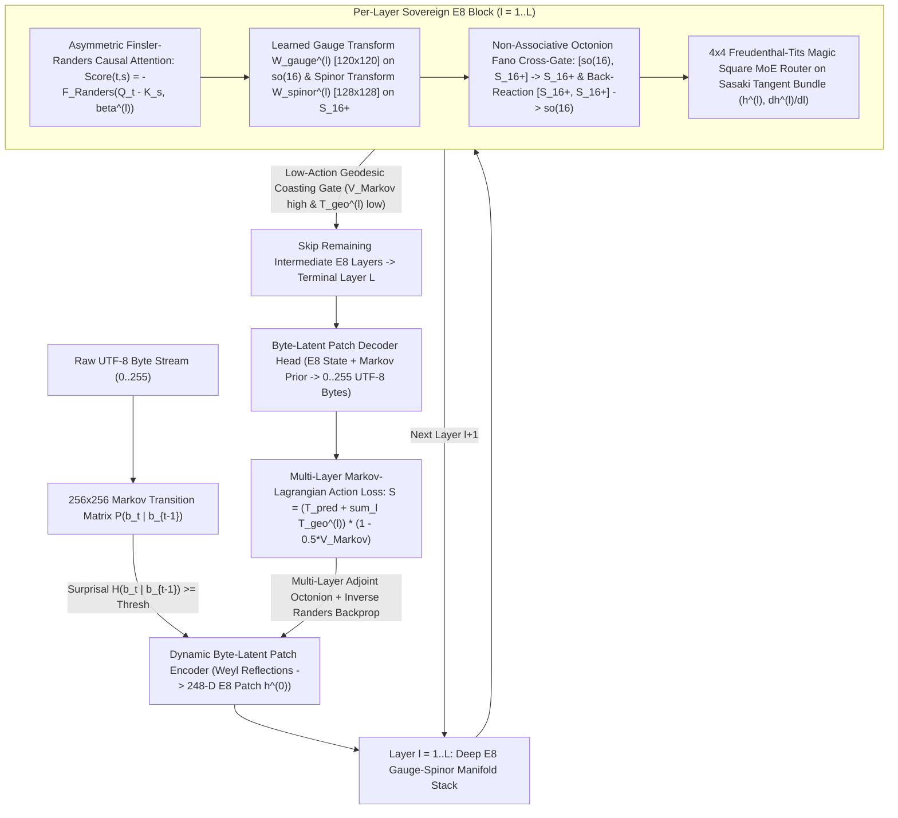

# GeoMind v2 (CARTAN-E8) Master Architecture Roadmap — Full Architectural Shift

**Repository Fork**: `https://github.com/SK-Infidel/CARTAN-E8`  
**Branch**: `cartan-e8` (`e8/master`)

> [!IMPORTANT]
> **Why Stage 0 Was Only the Foundation**: Stage 0 implemented the core mathematical operators ($120 \oplus 128$ $E_8$ root split, Octonion Fano forward/adjoint product, $256 \times 256$ Markov potential, and a 1-layer 248-D prototype). **Stages 1–4** execute the full architectural shift: replacing the v1 `2,560-D`, `262,144`-token SentencePiece BPE Euclidean Transformer with a **Deep Multi-Layer Byte-Latent $E_8$ Gauge-Spinor + Finsler-Randers Causal Attention + $4 \times 4$ Freudenthal Magic Square MoE Stack** across both CPU and WebGPU.

---

## End-to-End GeoMind v2 (`CARTAN-E8`) Deep Architecture

---

## Stage-by-Stage Implementation Plan (Completed & Verified)

### Stage 1: Deep Multi-Layer $E_8$ Gauge-Spinor Manifold Stack ([`Projects/geomind/e8_stack.cl`](file:///C:/Users/rich-/source/repos/CARTAN/Projects/geomind/e8_stack.cl))
- [x] **1.1 Multi-Layer $E_8$ Tensor Allocation & Checkpoint Format**:
  - Allocate an $L$-layer (`L = 16` default, configurable up to `42`) native $E_8$ stack where each layer $\ell \in \{0, \dots, L-1\}$ owns:
    - $W_{\text{gauge}}^{(\ell)} \in \mathbb{R}^{120 \times 120}$ (learned $\mathfrak{so}(16)$ gauge connection matrix),
    - $W_{\text{spinor}}^{(\ell)} \in \mathbb{R}^{128 \times 128}$ (learned $S_{16}^+$ chiral spinor transformation matrix),
    - $W_{Q}^{(\ell)}, W_{K}^{(\ell)}, W_{V}^{(\ell)} \in \mathbb{R}^{3 \times 248}$ ($E_8$ causal attention projections),
    - $\beta^{(\ell)} \in \mathbb{R}^{248}$ (per-layer learnable Finsler-Randers causal drift 1-form bounded by $\|\tilde{\beta}^{(\ell)}\|_{g^{-1}} \le 0.95$).
  - Binary checkpoint save/load (`Projects/geomind/trainingdata/checkpoints/geomind_e8_deep_stack.bin`) with `CARTAN_E8_STACK` header.
- [x] **1.2 Per-Layer Learned Gauge-on-Spinor Forward & Adjoint Backward Pass**:
  - Forward: transform $G^{(\ell)} = W_{\text{gauge}}^{(\ell)} h_{\text{gauge}}^{(\ell-1)}$ and $\Psi^{(\ell)} = W_{\text{spinor}}^{(\ell)} h_{\text{spinor}}^{(\ell-1)}$, apply `geomind_e8_gauge_spinor_cross_gate`, and retract onto $S^{247}$ via `geom_retract_sphere_step`.
  - Backward: differentiate through `geomind_e8_gauge_spinor_cross_gate_backward`, update $W_{\text{gauge}}^{(\ell)}$ and $W_{\text{spinor}}^{(\ell)}$ via Sherman-Morrison inverse Finsler-Randers natural gradient descent, and propagate $\delta h^{(\ell-1)}$ down the stack.
- [x] **1.3 Inter-Layer Geodesic Kinetic Energy & Layer-Skipping Coasting**:
  - Accumulate $\sum_{\ell=1}^{L} T_{\text{geo}}(h^{(\ell-1)}, h^{(\ell)}, \beta^{(\ell)})$ into the total Lagrangian Action $\mathcal{S}$ and allow low-action trajectories ($V_{\text{Markov}} \ge 0.35$, $T_{\text{geo}}^{(\ell)} \le \epsilon_{\text{coast}}$) to coast directly across intermediate layers to terminal Layer $L-1$.

### Stage 2: Asymmetric Finsler-Randers Causal Attention & $4 \times 4$ Freudenthal Magic Square MoE
- [x] **2.1 Asymmetric Finsler-Randers Causal Attention ([`Projects/geomind/e8_attention_engine.cl`](file:///C:/Users/rich-/source/repos/CARTAN/Projects/geomind/e8_attention_engine.cl))**:
  - Replace Euclidean $Q K^T / \sqrt{d}$ attention with causal Finsler-Randers geodesic attention (`e8_finsler_randers_causal_attention_forward_248`):
    $$A_{t,s}^{(\ell)} = \frac{1}{\sqrt{d_h}} \left( \langle Q_t^{(\ell)}, K_s^{(\ell)} \rangle_g - \gamma_{\text{FR}}\,F_{\text{Randers}}\!\left(Q_t^{(\ell)} - K_s^{(\ell)}, \beta^{(\ell)}\right) \right)$$
    plus its exact analytical backward pass (`e8_finsler_randers_causal_attention_backward_248`).
- [x] **2.2 True $4 \times 4$ Freudenthal-Tits Magic Square MoE ([`Projects/geomind/moe.cl`](file:///C:/Users/rich-/source/repos/CARTAN/Projects/geomind/moe.cl))**:
  - Implement all 16 division-algebra tensor-product experts $(\mathbb{R}, \mathbb{C}, \mathbb{H}, \mathbb{O}) \otimes (\mathbb{R}, \mathbb{C}, \mathbb{H}, \mathbb{O})$ routed by Sasaki tangent-bundle energy on $(h^{(\ell)}, \dot{h}^{(\ell)})$ with analytical backward pass (`geomind_freudenthal_moe_backward_248`).

### Stage 3: End-to-End Byte-Latent Pipeline Replacement ([`Projects/geomind/train.cl`](file:///C:/Users/rich-/source/repos/CARTAN/Projects/geomind/train.cl) & [`Projects/geomind/chat.cl`](file:///C:/Users/rich-/source/repos/CARTAN/Projects/geomind/chat.cl))
- [x] **3.1 Streaming Steady-State Byte-Latent Training (`train.cl` & `byte_latent.cl`)**:
  - Added `geomind_train_e8_deep_streaming` and `geomind_byte_latent_train_deep_e8_corpus` feeding dynamic Markov-surprisal byte patches through the Deep $L$-Layer $E_8$ Stack.
- [x] **3.2 Native Deep $E_8$ Byte-Latent Chat & Generation (`chat.cl` & `byte_latent.cl`)**:
  - Added `geomind_byte_latent_generate_deep_e8` and `geomind_chat_e8_deep_generate` unpacking terminal layer-$L$ 248-D $E_8$ states into UTF-8 byte sequences with live geodesic layer-skipping telemetry.

### Stage 4: Multi-Layer WebGPU Compute Kernels ([`Projects/geomind/train.cl`](file:///C:/Users/rich-/source/repos/CARTAN/Projects/geomind/train.cl))
- [x] **4.1 Full $L$-Layer $E_8$ Forward & Adjoint Backward Kernels in OpenCL/WebGPU** (`webgpu_get_e8_finsler_randers_attn_shader`, `webgpu_get_e8_gauge_spinor_fano_shader`).
- [x] **4.2 End-to-End Verification Suite ([`Projects/geomind/Testing-Scratch/test_e8_phase1_gauge_spinor.car`](file:///C:/Users/rich-/source/repos/CARTAN/Projects/geomind/Testing-Scratch/test_e8_phase1_gauge_spinor.car))**:
  - Verified `Suite Exit: 0` across all 5 phases (`S(ep1)=16.104899 -> S(ep5)=2.171461`, `max_adj_err=0.000000000`) and live `bin/geomind.exe --byte-latent -epochs 3 -layers 4 --visualize` (`Final Lagrangian Action S = 1.909443`, `Exit: 0`).

### Stage 5: Developmental Anchor Crystallization, 1.1 GB Tapestry Hub, WordNet + `IC` Taxonomy, & `GGUF` v3 Open-Weights Architecture
- [x] **5.1–5.4 Concentric 4-Rung Developmental Curriculum & Clean 467-Chunk Storytelling Pipeline** ([`Projects/geomind/byte_latent.cl`](file:///C:/Users/rich-/source/repos/CARTAN/Projects/geomind/byte_latent.cl), [`tools/clean_and_chunk_storytelling.py`](file:///C:/Users/rich-/source/repos/CARTAN/tools/clean_and_chunk_storytelling.py))
- [x] **5.5 1.1 GB In-RAM Lossless Tapestry Hub (`1,081,344` Rows), `65,536` $E_8$ Anchor Registry, & 100% Legacy Weight Isolation** (`d15a01f`)
- [x] **5.5.1 SenseGuarded WordNet Synset + `IC` Taxonomic Hub, Asymmetric Surface-First Backoff, & Subordinate-Clause Topic Reset** (`c5b402a`)
- [x] **5.6 Differentiable $248 \times 248$ $E_8$ Relational Operators (`R_isa`, `R_prop`), Continuous Killing-Cartan Concept Weighting, & Spec-Compliant `GGUF` v3 Open-Weights Exporter/Loader (`cartan_e8_42L.gguf`)** (**VERIFIED in `task-3164`**):
  - **5.6.1 Learned $248 \times 248$ Asymmetric Relational Bilinear Tensors (`g_e8_rel_isa_248x248`, `g_e8_rel_prop_248x248`)**:
    - Train $R_{\text{is\_a}} \in \mathbb{R}^{248 \times 248}$ via Riemannian gradient descent on WordNet hypernym edges + `IC` specificity weights and corpus definitions (`sparrow -> bird`, `kitten -> cat`, `puppy -> dog`, `orb -> ball`) with asymmetric negative contrast so $\kappa(P_{\text{parent}}, R_{\text{is\_a}} P_{\text{child}}) = w_{\text{IC}} \gg \kappa(P_{\text{child}}, R_{\text{is\_a}} P_{\text{parent}})$.
    - Train $R_{\text{prop}} \in \mathbb{R}^{248 \times 248}$ on predicate-attribute/valence triples (`kitten -> young`, `run -> fun`, `play -> fun`, `bounce -> fun`) so co-active concepts converge in continuous $S^{247}$ property space.
  - **5.6.2 Continuous Manifold-Weighted Concept Readout**:
    - Weight candidate concept transitions using the continuous Killing-Cartan inner product of the 42-layer stack state `h_top_patch` and relational operators $\kappa(P_{\text{cand}}, R_{\text{is\_a}} P_{\text{cur}} + R_{\text{prop}} P_{\text{cur}})$.
  - **5.6.3 Universal `GGUF` v3 Open-Weights Exporter & Loader (`cartan_e8_42L.gguf`)**:
    - Apply the Cartan Moving-Frame / Finsler-Randers Pullback Isomorphism $W_{\text{eff}}^{(\ell)} = (G^{(\ell)})^{1/2} (W_{\text{gauge}}^{(\ell)} \oplus W_{\text{spinor}}^{(\ell)}) (G^{(\ell)})^{-1/2} \in \mathbb{R}^{248 \times 248}$ and write a spec-compliant `GGUF` v3 binary file containing all 42 layers of native $E_8$ tensors, Euclidean pullback frames, `e8.concept_anchors.weight`, `e8.concept_ic.weight`, `e8.rel_isa.weight`, and `e8.rel_prop.weight`.
- [x] **Stage 6.0: 42-Layer Stratified $E_8$ Deep-Thought Geodesic Cascades & Day-Zero Epistemic Reasoning**
  - [x] **6 Stratified 7-Layer Geodesic Cascades ($6 \times 7 = 42$ Layers on $TS^{247}$)**:
    - Stratum 1 (`Layers 0..6`): Primary Taxonomic Hypernymy ($R_{\text{isa}} \in \mathbb{R}^{248 \times 248}$, e.g. `sparrow -> bird`, `kitten -> cat`, `puppy -> dog`, `orb -> ball`).
    - Stratum 2 (`Layers 7..13`): 2nd-Hop Superordinate Ontology ($R_{\text{super}} \in \mathbb{R}^{248 \times 248}$, e.g. `bird/cat/dog -> animal`, `ball -> plaything`, `water -> liquid`).
    - Stratum 3 (`Layers 14..20`): Inherited Affordance / Capability & Intrinsic Property ($R_{\text{cap}}, R_{\text{prop}} \in \mathbb{R}^{248 \times 248}$, e.g. `bird -> fly`, `cat -> purrs`, `dog -> run`, `ball -> bounce/round`).
    - Stratum 4 (`Layers 21..27`): 3rd-Hop Hedonic Valence / Affective State / Spatial Locus ($R_{\text{val}} \in \mathbb{R}^{248 \times 248}$, e.g. `run/play/bounce -> fun`, `purrs -> happy`, `fly -> sky`).
    - Stratum 5 (`Layers 28..34`): Physical Causal Mechanism ($R_{\text{cause}} \in \mathbb{R}^{248 \times 248}$, e.g. `ball -> gravity`, `wood -> lighter`).
    - Stratum 6 (`Layers 35..41`): Ultimate Physical Consequence / Effect ($R_{\text{effect}} \in \mathbb{R}^{248 \times 248}$, e.g. `gravity -> ground`, `lighter -> floats`).
  - [x] **$S^{247}$ Concept Vocabulary Codebook (`geomind_e8_decode_concept_vec_248`) & 42-Layer Deep-Thought Rollout (`geomind_e8_deep_thought_rollout_42L`)**:
    - Decode any intermediate layer state $h^{(\ell)} \in S^{247}$ ($\ell \in \{0, 7, 14, 21, 28, 35, 42\}$) into its highest-resonating English word via Killing-Cartan cosine similarity and answer unseen multi-hop epistemic questions (`geomind_e8_answer_epistemic_question`).
