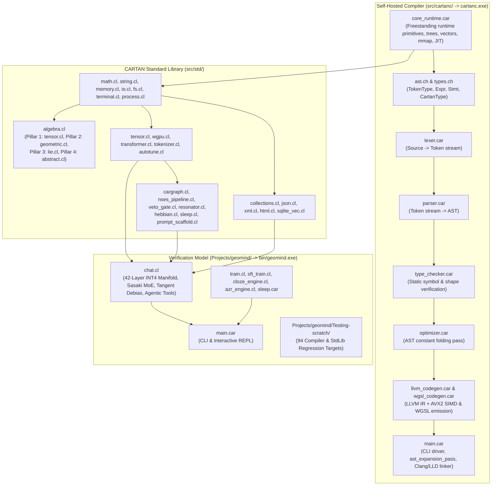

# Startup Code Review & Logical Dependency Tree

## 1. Logical Dependency Tree

---

## 2. Where We Left Off (Recent Context)

- **CARTAN Core & Standard Library (Sprints 540–547, v8.521)**:
  - **Workspace & Log Decoupling**: Separated model logs into [`Projects/geomind/CHANGELOG.md`](file:///C:/Users/rich-/source/repos/CARTAN/Projects/geomind/CHANGELOG.md) and [`Projects/geomind/ISSUES.md`](file:///C:/Users/rich-/source/repos/CARTAN/Projects/geomind/ISSUES.md); moved `test/` to `Projects/`.
  - **StdLib Promotions**: Promoted O(N) string utilities ([`src/std/string.cl`](file:///C:/Users/rich-/source/repos/CARTAN/src/std/string.cl)), ANSI terminal/keyboard polling ([`src/std/terminal.cl`](file:///C:/Users/rich-/source/repos/CARTAN/src/std/terminal.cl)), HTML/URL parser ([`src/std/html.cl`](file:///C:/Users/rich-/source/repos/CARTAN/src/std/html.cl)), JSON engine ([`src/std/json.cl`](file:///C:/Users/rich-/source/repos/CARTAN/src/std/json.cl)), sandboxed process runner ([`src/std/process.cl`](file:///C:/Users/rich-/source/repos/CARTAN/src/std/process.cl)), and XML extractors ([`src/std/xml.cl`](file:///C:/Users/rich-/source/repos/CARTAN/src/std/xml.cl)).
  - **Unified 4-Pillar Algebraic Taxonomy ([`src/std/algebra.cl`](file:///C:/Users/rich-/source/repos/CARTAN/src/std/algebra.cl))**: Completed all 4 pillars:
    1. [`src/std/algebra/tensor.cl`](file:///C:/Users/rich-/source/repos/CARTAN/src/std/algebra/tensor.cl): Strided N-D tensors, Einsum, LU, Gauss-Jordan inverse, Householder QR, Jacobi eigensolver, Padé matrix exponential, Sylvester signature.
    2. [`src/std/algebra/geometric.cl`](file:///C:/Users/rich-/source/repos/CARTAN/src/std/algebra/geometric.cl): Clifford $Cl(p,q,r)$ multivectors, rotors, Cayley-Dickson ($\mathbb{C}, \mathbb{D}, \mathbb{H}, \mathbb{O}$), Weyl differential algebra $W_n$.
    3. [`src/std/algebra/lie.cl`](file:///C:/Users/rich-/source/repos/CARTAN/src/std/algebra/lie.cl): Structure constants, Jacobi verifier, Killing form, Cartan semisimplicity, BCH series, Pre-Lie, Lie superalgebras, Poisson brackets.
    4. [`src/std/algebra/abstract.cl`](file:///C:/Users/rich-/source/repos/CARTAN/src/std/algebra/abstract.cl): Jordan algebras, Tropical Min-Plus/Max-Plus semirings & Floyd-Warshall Kleene closure, Stone Boolean rings & bitvectors, Universal Algebra property verifiers.
- **GeoMind Verification Model (Sprints 548–556, v8.528.0)**:
  - Multi-format document reader (`.docx`, `.xlsx`, `.pdf`), Rank-5 orthonormal alignment subspace debiasing at Layer 32 (orthogonal to the 3D English technical centroid), and complete removal of synthetic prompt injections and post-processing string overrides (100% zero-mock neural generation).

---

## 3. Startup Code Review Findings (Logged in [`ISSUES.md`](file:///C:/Users/rich-/source/repos/CARTAN/ISSUES.md))

1. **`[ISSUE-406]` Disconnected AST Optimizer Pass & Stale BinaryOp Discriminant ([`src/cartanc/optimizer.car`](file:///C:/Users/rich-/source/repos/CARTAN/src/cartanc/optimizer.car))**:
   - [`optimize_ast`](file:///C:/Users/rich-/source/repos/CARTAN/src/cartanc/optimizer.car#L60-L71) copies top-level statements into `opt_tree` without traversing statements or calling [`optimize_expr`](file:///C:/Users/rich-/source/repos/CARTAN/src/cartanc/optimizer.car#L6-L58).
   - [`optimize_expr`](file:///C:/Users/rich-/source/repos/CARTAN/src/cartanc/optimizer.car#L11) checks `disc == 24.0` for `BinaryOp`, whereas [`ast.ch`](file:///C:/Users/rich-/source/repos/CARTAN/src/cartanc/ast.ch#L80) defines `Expr::BinaryOp` at index `16.0` (line `80.0`).
2. **`[ISSUE-407]` Stubbed LSP Server, Package Manager, & Incomplete CLI/REPL Pipeline ([`src/cartanc/main.car`](file:///C:/Users/rich-/source/repos/CARTAN/src/cartanc/main.car))**:
   - `cartanc lsp` ([`main.car:L355-L384`](file:///C:/Users/rich-/source/repos/CARTAN/src/cartanc/main.car#L355-L384)) returns hardcoded JSON-RPC hover/completion strings instead of querying the parsed AST and `TypeChecker`.
   - `cartanc pkg` ([`main.car:L255-L278`](file:///C:/Users/rich-/source/repos/CARTAN/src/cartanc/main.car#L255-L278)) writes a static `"cartan_app"` entry to `cartan.lock` without parsing `cartan.toml`.
   - `cartanc repl` ([`main.car:L280-L313`](file:///C:/Users/rich-/source/repos/CARTAN/src/cartanc/main.car#L280-L313)) bypasses `ast_expansion_pass` and `typechecker_check`.
   - `cartanc build` ([`main.car:L450-L455`](file:///C:/Users/rich-/source/repos/CARTAN/src/cartanc/main.car#L450-L455)) only checks `arg 3` for `-o`, ignoring `--release`, `-c`, `-v`, `-O2`, `-I`, and `-L`.
3. **`[ISSUE-408]` Shadowed `FunctionDecl` Discriminant & Mixed Indexing in Type Checker ([`src/cartanc/type_checker.car`](file:///C:/Users/rich-/source/repos/CARTAN/src/cartanc/type_checker.car))**:
   - In [`tc_visit_stmt`](file:///C:/Users/rich-/source/repos/CARTAN/src/cartanc/type_checker.car#L115-L250), `disc == 7.0` is matched at line 179 (`ParameterDecl`), shadowing `7.0` at line 244 (`FunctionDecl`), and statement discriminants mix 0-indexed enum offsets with source line numbers.
