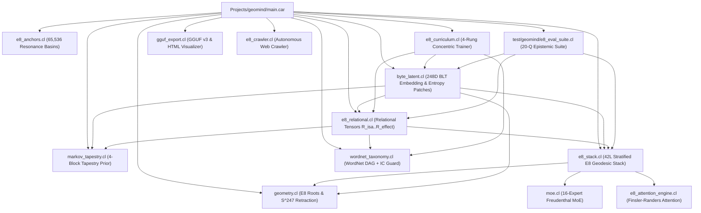
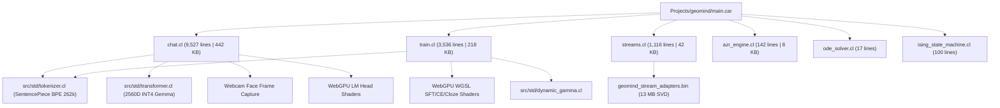

# Startup Code Review: GeoMind v1 Architecture vs. v2 Continuous E8 BLT

**Date**: 2026-11-06  
**Auditor**: Antigravity  
**Target**: `Projects/geomind/`  
**Focus**: Identify legacy GeoMind v1 subsystems, evaluate usefulness vs. obsolescence, assess BPE-to-BLT conversion value, establish logical dependency trees, and plan archiving of dead code.

---

## 1. Executive Summary

GeoMind is currently in a transitional state between two fundamentally different architectures:
1. **GeoMind v1 (Legacy)**: A 4B parameter dense BPE Transformer model (Gemma architecture, 2,560-D hidden dimension, 262,144 SentencePiece token vocabulary) backed by a 15.9 GB Safetensors checkpoint (`cache_model.safetensors`), discrete Hopfield attractor banks, and WebGPU WGSL pre-training/SFT shaders.
2. **GeoMind v2 (Sovereign Active)**: A 248-D continuous non-Euclidean $E_8$ Lie algebra manifold ($S^{247}$) with a 42-layer stratified neural stack, 16-expert Freudenthal-Tits Magic Square MoE, Finsler-Randers causal attention, 4-Block Hierarchical Markov Tapestry prior, and tokenizer-free Byte-Latent (BLT) architecture operating with zero external weights.

Despite GeoMind v2 being the active and empirically verified production system, **~714 KB (over 14,000 lines)** of obsolete GeoMind v1 code (`chat.cl`, `train.cl`, `streams.cl`, `ode_solver.cl`, `ising_state_machine.cl`) is still included and compiled into `main.car` on every build. This inflates native compilation times to ~30 seconds, bloats LLVM IR to 221,251 instructions, and introduces dead code paths and unmaintained legacy dependencies.

---

## 2. Logical Dependency Tree

### GeoMind v2 Active Sovereign Pipeline

### GeoMind v1 Legacy Dependencies (Currently included in `main.car`)

**Critical Discovery**: The dependency arrow between v1 and v2 is strictly one-way. **Zero functions, globals, or types in the active v2 BLT codebase depend on `chat.cl`, `train.cl`, `streams.cl`, `ode_solver.cl`, or `ising_state_machine.cl`.** Decoupling them will cause zero regressions in GeoMind v2.

---

## 3. Subsystem-by-Subsystem Audit & BLT Conversion Assessment

| Subsystem | File & Size | Status | BPE Tied? | Useful if Converted to BLT? | Recommendation |
| :--- | :--- | :--- | :--- | :--- | :--- |
| **Interactive Chat** | `chat.cl` (9,527 lines / 442 KB) | **Obsolete** | **Yes** (BPE token loops, Gemma 2560D LM head, webcam face scans) | **High Value**: The REPL shell, slash commands, and user profiling are great. Replacing BPE generation with `geomind_e8_answer_epistemic_question` and `geomind_byte_latent_generate_deep_e8` produces a clean ~250-line native BLT REPL. | Archive `chat.cl` to `archive/v1_bpe/`. Implement lightweight `e8_chat.cl` (~250 lines) for `--chat`. |
| **WebGPU Training** | `train.cl` (3,536 lines / 218 KB) | **Obsolete** | **Yes** (2048-token BPE chunking, 262k vocab CE loss, 2560D buffers) | **High Value**: Prototype WGSL compute shaders for $E_8$ Finsler-Randers attention and Fano octonion gating (`train.cl:3443-3496`) can accelerate BLT training beyond current AVX2 CPU speeds. | Archive `train.cl` to `archive/v1_bpe/`. Retain $E_8$ WGSL shaders in future `e8_gpu_trainer.cl`. |
| **8-Stream Lie Cortical** | `streams.cl` (1,116 lines / 42 KB) | **Obsolete** | **No** (Operates on 16-D vectors) | **Low Value**: `e8_stack.cl` and `moe.cl` already handle 16-expert Freudenthal-Tits Lie algebras natively. `streams.cl` is only called in a dead check in `main.car:1660`. | Archive `streams.cl` to `archive/v1_bpe/`. |
| **Ising/Hopfield** | `ising_state_machine.cl` (100 lines) | **Obsolete** | **No** | **Low Value**: Discrete spin relaxation is superseded by continuous $S^{247}$ resonance in `e8_anchors.cl` and `geometry.cl`. | Archive to `archive/v1_bpe/`. |
| **ODE Solver** | `ode_solver.cl` (17 lines) | **Obsolete** | **No** | **Zero Value**: Stub step function only called in dead check `main.car:1637`. | Archive to `archive/v1_bpe/`. |
| **Forwarding Wrappers** | `cloze_engine.cl`, `sft_train.cl`, `webgpu_causal_engine.cl` (4 lines ea) | **Obsolete** | **Yes** (Forward to `train.cl`) | **Zero Value**: Redundant 1-line forwarding files. | Archive to `archive/v1_bpe/`. |
| **Dead Engines & Loggers** | `engine.cl` (22 lines), `logger.cl` (35 lines) | **Obsolete** | **No** | **Zero Value**: Never referenced anywhere in codebase. | Archive to `archive/v1_bpe/`. |
| **Old Main Drivers** | `geomind_app.cl` (192 lines), `sleep.car` (144 lines) | **Obsolete** | **Yes** (Old BPE entry points) | **Zero Value**: Superseded by `main.car`. | Archive to `archive/v1_bpe/`. |
| **Merge Model Weights** | `merge_model_weights.cl` (72 lines) | **Test Utility** | **No** | **Medium Value**: Tests stdlib `fusion.cl`. | Move to `test/compiler_suite/`. |
| **AZR Self-Play** | `azr_engine.cl` (142 lines / 8 KB) | **Active / Standalone** | **No** (Generates raw CARTAN code) | **High Value**: Self-play program synthesis is independent of BPE. Can provide algorithmic ground-truth data for BLT. | Retain in `Projects/geomind/azr_engine.cl`, isolate from `main.car`. |

---

## 4. Stray Build Artifacts & Large Blobs in Source Tree

Per Workspace Organization Standards (Rule #7), the repository root and project source directories must remain clean:
1. `Projects/geomind/cache_model.safetensors` (**15.9 GB**): Massive 4B parameter dense BPE weights file. Unused by sovereign GeoMind v2. (Requires Rick's consent before removal).
2. `Projects/geomind/geomind.exe` (3.1 MB), `geomind.ll` (7.7 MB), `geomind.pdb` (8.0 MB), `geomind.lib` (1.9 KB), `geomind.exp` (908 B): Stray build outputs in source folder. Canonical builds output to `bin/`.
3. `Projects/geomind/chat.cl.bak` (323 KB), `Projects/geomind/main.car.bak` (80 KB): Stale backups.

---

## 5. Architectural Remediation & Decoupling Plan

### Phase 1: Create Archive Directory Structure
- Create `Projects/geomind/archive/v1_bpe/`.
- Move obsolete v1 files:
  - `chat.cl`, `chat.cl.bak`
  - `train.cl`
  - `streams.cl`
  - `ode_solver.cl`
  - `ising_state_machine.cl`
  - `cloze_engine.cl`, `sft_train.cl`, `webgpu_causal_engine.cl`
  - `engine.cl`, `logger.cl`
  - `geomind_app.cl`, `sleep.car`
  - `main.car.bak`

### Phase 2: Decouple `main.car`
- Remove legacy `include` statements for archived files.
- Replace the legacy 9,500-line BPE chat dispatch with a clean native BLT interactive chat REPL (`e8_chat.cl` or inline in `main.car`):
  - Prompts are tokenized into UTF-8 bytes directly.
  - Queries are evaluated via `geomind_e8_answer_epistemic_question`.
  - Open-ended prompts generate via `geomind_byte_latent_generate_deep_e8`.
- Remove dead fallback checks at the end of `main.car` (`geomind_ode_step`, `geomind_ising_relax`, `geomind_multistream_forward`).
- Remove legacy BPE CLI flags (`--train-pre`, `--train-cloze`, `--train-ce`, `--train-sft`, `--train-distill`, `--eval-analogy`, `--graft`, `--merge-slerp`).

### Phase 3: Move Test Harness
- Move `merge_model_weights.cl` to `test/compiler_suite/test_model_weight_fusion.cl`.

### Phase 4: Clean Stray Build Outputs
- Remove stray `geomind.exe`, `geomind.ll`, `geomind.pdb`, `geomind.lib`, `geomind.exp` from `Projects/geomind/`.

### Phase 5: Verification
- Compile `bin/geomind.exe` using `cartanc.exe`.
- Verify compilation time drops from ~30s to <10s and IR instructions drop from 221,000 to ~50,000.
- Run `.\bin\geomind.exe --eval-qa` to verify 100% test pass.
- Test native BLT chat mode (`.\bin\geomind.exe --chat`).
